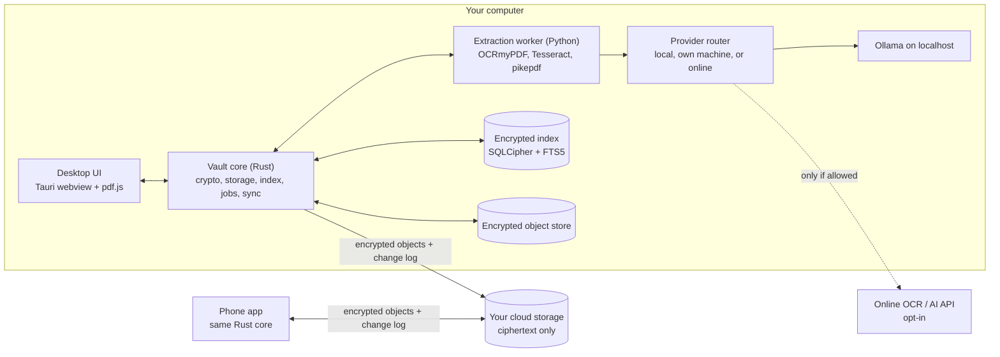
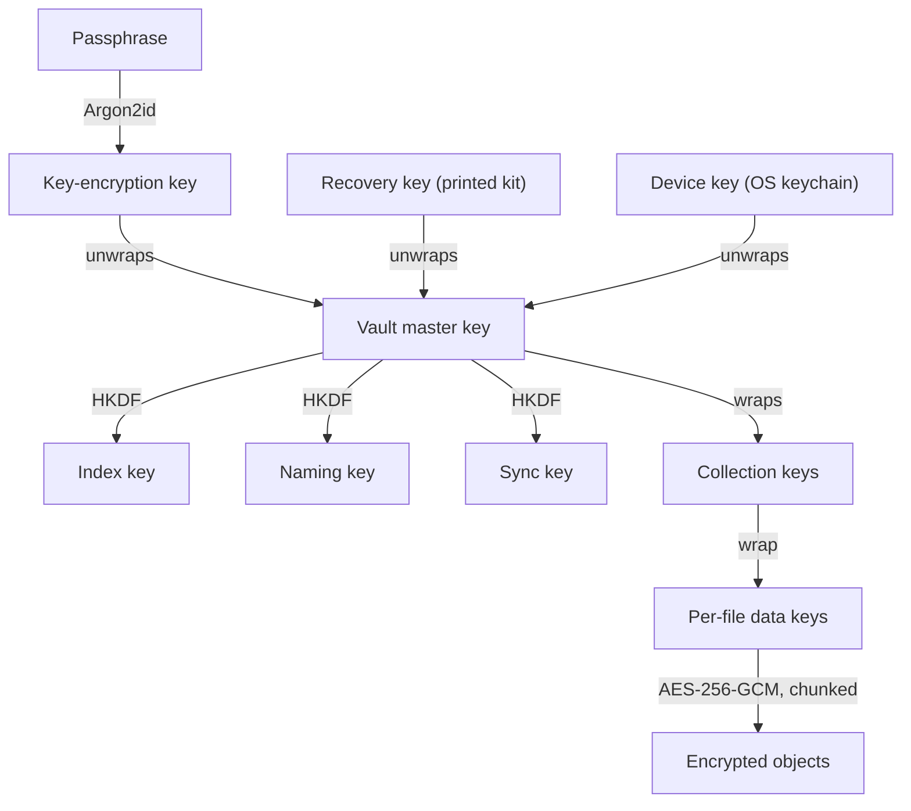
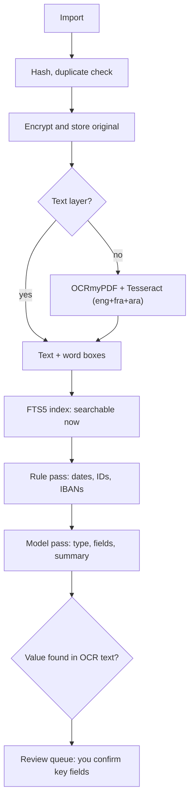

# Warca architecture

This is the reference summary of the Warca design. Individual decisions are recorded as ADRs in [`adr/`](adr/).

## Principles

1. **Your device is the source of truth.** The app works fully offline. The cloud is a replica and a transport, never a requirement.
2. **Plaintext never leaves your devices unless you say so.** Documents, thumbnails, OCR text, filenames and the search index are encrypted before they touch disk or the network. The only exception is an online OCR or AI provider you explicitly enable for a given kind of document.
3. **Originals are immutable.** OCR output, metadata and annotations are layers on top and can be regenerated.
4. **AI suggests, you decide.** Key fields stay unconfirmed until you accept them, and a confirmed value is never overwritten by a model.
5. **Boring, inspectable formats.** SQLite, PDF/A and a documented encryption container.

## Components



- **Vault core (Rust)** owns the keys and is the only component that reads or writes the vault.
- **Extraction worker (Python)** is a separate low-privilege process with no network access and no vault keys. It receives one decrypted document at a time over a pipe.
- **Provider router** sends each OCR or AI job to the provider allowed for that document: this computer (default), another machine you own, or an online API.

## Vault layout

```
MyVault.vault/
├── vault.json      # format version, KDF parameters, salt, wrapped keys
├── index.db        # SQLCipher: metadata, OCR text, FTS5 index, annotations
├── objects/        # encrypted write-once blobs, named by HMAC(naming key, id)
├── oplog/<device>/ # encrypted append-only change log, one folder per device
├── snapshots/      # encrypted metadata snapshots for fast bootstrap
└── trash/          # deleted objects, purged after 30 days
```

## Keys



The exact format is specified in [ADR 0001](adr/0001-crypto-format.md).

**Family sharing (later).** Version 1 is single user, but every user has an X25519 identity key pair and documents belong to collections. Sharing a collection means wrapping its key for a family member's public key; no file is re-encrypted.

## Extraction pipeline



- The model returns JSON that matches a fixed schema. Text is sent first; page images only when OCR confidence is low or the layout matters.
- Every extracted value is looked up in the OCR text; values that cannot be found are flagged.
- Document text is untrusted: the model has no tools and no network, so prompt injection can at worst produce wrong suggestions.

## Languages

Default language set: `eng+fra+ara`. Search normalises Arabic letter variants (أ إ آ → ا, ة/ه, ى/ي), removes tashkeel and tatweel, converts Eastern Arabic digits, and recognises Hijri dates. The UI uses automatic text direction.

## Sync and backup

- Objects are write-once and each device writes only its own change-log folder, so devices never write the same file.
- Changes carry hybrid logical clock timestamps; per field the latest wins, except that a user-confirmed value beats a model suggestion.
- The live SQLite file is never synced.
- Sync is not backup: Warca also makes scheduled encrypted backups and runs restore drills.

## Threat model (summary)

| Threat | Protection |
|---|---|
| Cloud breach or account takeover | Only ciphertext and HMAC names are uploaded |
| Stolen laptop or phone | Encrypted at rest, Argon2id, auto-lock, device revocation |
| Malicious PDF | Parsed in a sandboxed worker with no network and no keys |
| Online provider | Off by default, per-document privacy levels, redaction, audit badge |
| AI hallucination | Schema output, grounding check, human confirmation |
| Data loss | Write-once objects, 30-day trash, versioned and offline backups |
| Malware on an unlocked device | Out of scope |
